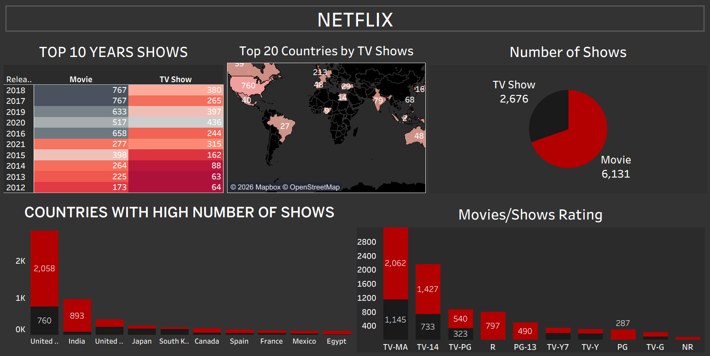

# Netflix Movies and TV Shows Analysis | Tableau Dashboard

## Project Overview

This project presents an interactive Netflix Movies and TV Shows Dashboard developed using Tableau.

The dashboard analyzes Netflix content based on release years, countries, content types, and ratings. It provides a visual overview of the distribution of movies and TV shows and helps explore content trends across different dimensions.

The dataset contains 8,807 records and 12 columns.

## Dashboard Preview

## Key Performance Indicators (KPIs)

| Metric | Total |
|---|---:|
| Total Movies | 6,131 |
| Total TV Shows | 2,676 |
| Total Titles | 8,807 |

## Key Analysis & Visualizations

The dashboard includes the following analyses:

1. **Top 10 Years of Shows:** Compares the number of movies and TV shows released across different years.
2. **Top 20 Countries by TV Shows:** Displays the countries contributing the highest numbers of TV shows.
3. **Movies vs TV Shows:** Compares the overall distribution of movies and TV shows.
4. **Country-wise Content Distribution:** Identifies countries with high numbers of Netflix titles.
5. **Movies and TV Shows by Rating:** Analyzes content distribution across different audience rating categories.
   
## Dataset Description

The `netflix_titles.csv` dataset contains 8,807 records and 12 columns, including:

- Show ID
- Type (Movie or TV Show)
- Title
- Director
- Cast
- Country
- Date Added
- Release Year
- Rating
- Duration
- Listed In (Genres and Categories)
- Description

## Tools & Technologies

- Tableau Desktop
- Microsoft Excel / CSV
- Data Visualization
- Exploratory Data Analysis (EDA)
- Business Analytics

## Project Files

| File | Description |
|---|---|
| `Netflix Dashboard.twbx` | Packaged Tableau workbook |
| `NETFLIX.png` | Dashboard screenshot |
| `netflix_titles.csv` | Netflix titles dataset |

## Key Observations

- Movies account for 6,131 titles, while TV Shows account for 2,676 titles.
- Movies represent the larger share of the content catalog.
- The dashboard highlights the distribution of content across release years and countries.
- Content ratings provide another way to understand the composition of the Netflix catalog.

## Conclusion

This project demonstrates how Tableau can transform a Netflix titles dataset into an interactive analytical dashboard. It provides a visual understanding of content distribution, release-year trends, country-wise representation, and movie and TV show ratings.

---

**Created by:** Ashish Kumar

**Project Category:** Data Analytics | Tableau

**GitHub Repository:** Netflix Movies and TV Shows Analysis
